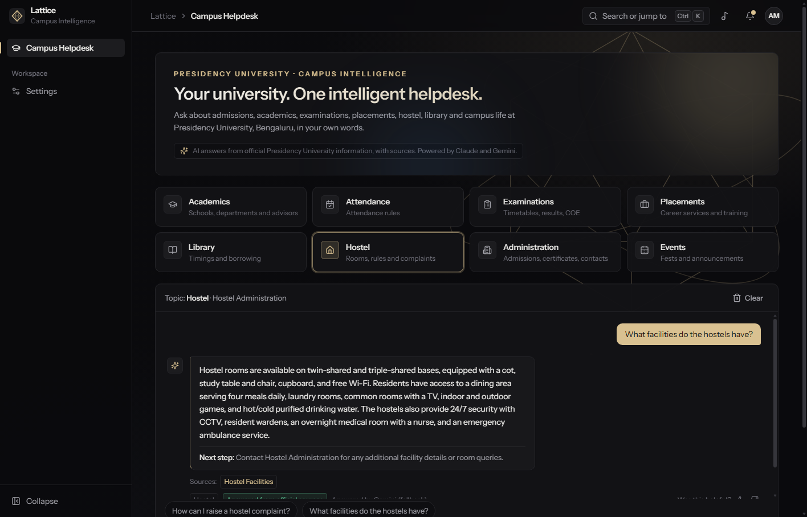
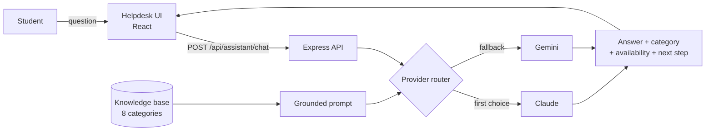
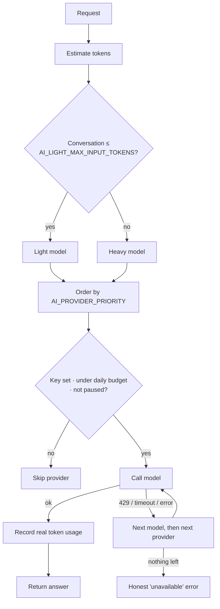
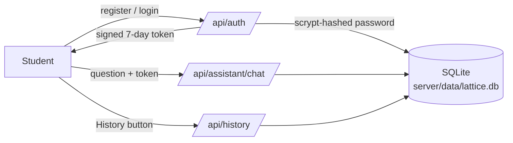

# Lattice — Campus Intelligence

An AI helpdesk for **Presidency University, Bengaluru**. Students ask in plain language and get specific answers, with source links, drawn from the university's own published pages.

Built for **TECHNOPIA 2.0** · Presidency University.



---

## How it works



1. The student types a question or picks a suggestion.
2. The server builds a grounded prompt from the numbered knowledge-base facts. Claude and Gemini share the same facts.
3. The router picks a provider and model, and calls exactly one of them.
4. The reply comes back with its topic, whether it is covered, a next step, the source pages used and the provider that wrote it.

If the information isn't in the knowledge base, the assistant says so and never invents dates, fees, names or numbers.

## Provider routing



| Rule | Detail |
|---|---|
| One call per question | Fallback only when a call fails. Each candidate is tried once. |
| Model tiers | Light for normal questions, heavy for long conversations, plus backup models with their own quota. |
| Budgets | Daily token limits per provider, counted from real API usage. |
| Circuit breaker | Billing or auth errors pause that provider for 5 minutes. |
| Safety | Keys stay on the server. Input is validated. Requests are rate-limited per client. |
| No mock output | If every provider fails, the user sees an error with a retry. |

## Knowledge base

`src/data/campusKnowledge.json` holds 39 facts across eight topics, each tied to the official page it came from (presidencyuniversity.in: Library, Hostel Facilities, Examinations, Time Table, Placements, Admissions, Contact, Student Handbook and others). Both models receive the same facts, and every answer returns the sources it used.

| Topic | Examples of what it can answer |
|---|---|
| Academics | The 11 schools, CBCS, academic calendar, faculty advisor |
| Attendance | Where the rules are, hostel class-hour rule |
| Examinations | Timetables, results portal, grade review, document verification |
| Placements | Career Services, director contact, internships |
| Library | Timings, locations, collection, services |
| Hostel | Rooms, facilities, curfew, complaints |
| Administration | Admissions contacts, Registrar, alumni office, campus address |
| Events | Where announcements are posted, upcoming events |

If a detail isn't in the knowledge base (for example a course fee or a warden's name), the assistant says so and points to the right office. It never invents it. Facts were compiled on 11 Nov 2026 and can change, so confirm on official channels. To add information, edit the JSON file.

## Features

- Chat with multi-turn context, live typing-style replies, Enter to send, retry on error, and clear.
- Eight topic shortcuts with suggested questions. Every suggestion goes through the AI.
- Each answer shows its category, whether it is covered, a next step, clickable source links and which provider answered.
- "Was this helpful?" feedback on every answer.
- Dark and light themes, a 3D background and an optional Spotify player.
- Settings shows live provider status and lets you send a test prompt.

## Accounts and saved data

Students can register and sign in. Signed-in students get a saved history of their questions and answers, each with a timestamp. Guests can still ask questions.



| Table | Stores |
|---|---|
| `users` | name, email, salted password hash, created and last-login time |
| `prompts` | question, answer, topic, provider, model, token counts, status, time (guest prompts have no user) |

Passwords are hashed with scrypt and never stored in plain text. Login attempts are rate-limited. Students can delete their own history from the History dialog.

## Project structure

```
src/pages/Helpdesk.tsx        helpdesk UI
src/data/campusKnowledge.json knowledge base
server/server.js              API: /api/assistant/chat, /api/ai, /api/assistant/status
server/ai/router.js           routing, budgets, fallback, rate limit
server/ai/providers.js        Claude + Gemini adapters
server/auth.js, server/db.js    accounts, tokens, SQLite storage
server/ai/prompt.js           grounded system prompt
```

## Run it

```bash
npm install && (cd server && npm install)
cp .env.example .env          # add ANTHROPIC_API_KEY and GEMINI_API_KEY
npm run server                # API  → http://localhost:3001
npm run dev                   # app  → http://localhost:3000
```

Main settings in `.env`: model IDs per provider (`*_MODEL_LIGHT/HEAVY/BACKUP`), `AI_PROVIDER_PRIORITY`, token thresholds, daily limits, `AI_MAX_OUTPUT_TOKENS` and `AI_RATE_LIMIT_PER_MINUTE`. The server checks the model IDs against each provider's live model list when it starts.

## Limitations

- The knowledge base covers what the public site and handbook state (no fees, warden names or attendance percentage), so those are answered as unavailable. Library timings come from the 2023 handbook.
- Usage counters and rate limits live in one server process. Feedback clicks stay in the browser.
- The SQLite file is local to the server machine; there is no backup or email verification, and tokens last 7 days with no server-side revoke.
